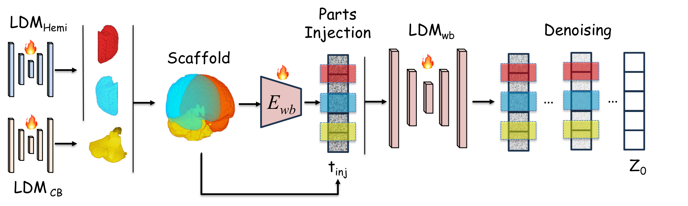

<div align="center">

<h1>AnaDiffusion</h1>

<p><strong>Anatomically Compositional Latent Diffusion for Controllable 3D Brain MRI Generation.</strong></p>

<p>
  <a href="https://arxiv.org/abs/2608.23014"></a>
  <a href="https://github.com/phai-lab/AnaDiffusion"></a>
  <a href="https://anadiffusion.github.io"></a>
</p>



</div>

> **AnaDiffusion** composes whole-brain MRI generation from anatomical part models. The model first synthesizes high-fidelity regional parts and assembles them into a whole-brain scaffold. The scaffold is re-encoded into the whole-brain latent space and injected during denoising, enabling local anatomical detail and globally coherent whole-brain synthesis.

<hr style="height: 5px; background: #4b5563; border: 0; border-radius: 999px; margin: 1.6rem 0;">

The repository includes data-preparation utilities, example metadata and split files, training scripts for autoencoders and latent diffusion models, and inference code for compositional whole-brain sampling.

The data examples in this repository use placeholder paths and de-identified example image IDs. Replace every `<PATH-TO-...>` value before running the pipeline on your own data.

# Contents

- [Repository Structure](#repository-structure)
- [Environment](#environment)
- [Preparing Your Own Dataset](#preparing-your-own-dataset)
- [Method](#method)
- [Training](#training)
- [Inference](#inference)
- [Evaluation](#evaluation)
- [Citation](#citation)
- [Acknowledgements](#acknowledgements)

# Repository Structure

```text
AnaDiffusion/
├── anadiffusion/             # Core method: templates, part experts, scaffold injection
│   ├── templates.py          # MNI152 template masks and binary morphology
│   ├── parts.py              # Part crops, frozen part experts (latent SDEdit), assembly
│   ├── compose.py            # Scaffold injection shared by training and inference
│   ├── models.py             # Autoencoder/UNet construction, schedules, checkpoints
│   ├── data.py               # Volume loading from the manifest CSV and split JSON
│   └── config.py             # JSON configs with command-line overrides
├── configs/
│   ├── train/                # AE and base LDM configs; ours/ holds the compositional config
│   ├── infer/                # Compositional generation and editing config
│   └── eval/                 # MedicalNet FID config
├── data/                     # Example metadata, splits, and template masks
│   └── template/dilated_r*/  # MNI152 brain and part masks dilated by r voxels
├── data_prep/                # Dataset conversion and part-volume preparation
├── scripts/
│   ├── train/                # AE, base LDM, and hemisphere LDM training
│   │   └── ours/             # Compositional (assemble-then-refine) training
│   ├── infer/                # Compositional generation and part editing
│   └── eval/                 # MedicalNet FID on template-defined supports
├── environment.yml
└── README.md
```

# Environment

Create the conda environment from the provided YAML:

```bash
conda env create -f environment.yml
conda activate monai
```

Run commands from the `AnaDiffusion/` directory unless noted otherwise.

# Preparing Your Own Dataset

Each sample is a brain MRI NIfTI volume indexed by a de-identified image ID such as `I000000`. Volumes should be preprocessed and registered to the MNI space before running this pipeline. See the Preprocessing section below.

The files below show the expected manifest and split-file formats:

<table>
  <tr>
    <td width="50%">
      <strong><code>data/MPRAGE-all.json</code></strong><br>
      Example metadata keyed by image ID.
    </td>
    <td width="50%">
      <strong><code>data/patient_splits_image_ids_75_10_15.json</code></strong><br>
      Example train/validation/test split.
    </td>
  </tr>
  <tr>
    <td>
<pre lang="json">{
  "I000000": {
    "Age": 76,
    "Sex": "F",
    "Group": "CN"
  }
}</pre>
    </td>
    <td>
<pre lang="json">{
  "train": ["I000000", "I000001"],
  "val": ["I000002"],
  "test": ["I000003"]
}</pre>
    </td>
  </tr>
</table>

Age, sex, and diagnostic group are not explicitly used during training or inference. They are included to support balanced train, validation, and test splits across participant conditions.

## Preprocessing

AnaDiffusion uses [Turboprep](https://github.com/LemuelPuglisi/turboprep) for preprocessing. If you use turboprep, its outputs are registered to the [MNI152](https://github.com/Washington-University/HCPpipelines/blob/master/global/templates/MNI152_T1_1mm_brain.nii.gz) template space and segmented using [SynthSeg](https://surfer.nmr.mgh.harvard.edu/fswiki/SynthSeg), organized as follows:

```text
<PATH-TO-TURBOPREP-OUTPUT>/
├── I000000/
│   ├── normalized.nii.gz
│   ├── mask.nii.gz
│   └── segm.nii.gz
└── I000001/
    ├── normalized.nii.gz
    ├── mask.nii.gz
    └── segm.nii.gz
```

## Postprocessing

<table>
  <tr>
    <td width="50%"><strong>Command</strong></td>
    <td width="50%"><strong>Output structure</strong></td>
  </tr>
  <tr>
    <td>
<pre lang="bash">python data_prep/turboprep_postproc.py \
  --root &lt;PATH-TO-TURBOPREP-OUTPUT&gt; \
  --outdir &lt;PATH-TO-PROCESSED-TURBOPREP-OUTPUT&gt;</pre>
    </td>
    <td>
<pre lang="text">&lt;PATH-TO-PROCESSED-TURBOPREP-OUTPUT&gt;/
└── I000000/
    ├── normalized.nii.gz
    ├── mask.nii.gz
    └── segm.nii.gz</pre>
    </td>
  </tr>
</table>

Then create whole-brain and part volumes plus training CSVs:

<table>
  <tr>
    <td width="50%"><strong>Command</strong></td>
    <td width="50%"><strong>Created outputs</strong></td>
  </tr>
  <tr>
    <td>
<pre lang="bash">python data_prep/prep_data.py \
  --root &lt;PATH-TO-PROCESSED-TURBOPREP-OUTPUT&gt; \
  --metadata_json &lt;PATH-TO-METADATA-JSON&gt; \
  --outdir &lt;PATH-TO-PROCESSED-PARTS-DIR&gt; \
  --postfix processed</pre>
    </td>
    <td>
      <ul>
        <li>Whole-brain volumes</li>
        <li>Left hemisphere volumes</li>
        <li>Mirrored right hemisphere volumes</li>
        <li>Substructure volumes</li>
        <li>Corresponding masks</li>
        <li>Corresponding CSVs</li>
      </ul>
    </td>
  </tr>
</table>

Generated CSV schemas:

| CSV type | Files | Used by | Columns |
| --- | --- | --- | --- |
| Per-part CSVs | `whole_brain_processed.csv`, `lhemi_processed.csv`, `rhemi_mirror_processed.csv`, `sub_processed.csv` | Autoencoder and single-part LDM training | `imageID`, `image`, `mask`, `part`, `vol`, `age`, `sex`, `group` |
| Combined whole-brain-plus-parts CSV | `whole_brain+3parts+masks_processed.csv` | Compositional training and inference | `imageID`, `age`, `sex`, `group`, `whole_brain`, `whole_brain_mask`, `whole_brain_vol`, `lhemi`, `lhemi_mask`, `lhemi_vol`, `rhemi_mirror`, `rhemi_mirror_mask`, `rhemi_mirror_vol`, `sub`, `sub_mask`, `sub_vol` |
| Paired hemisphere CSV | `hemi_processed.csv` | Hemisphere LDM training | `imageID`, `age`, `sex`, `group`, `image`, `mask`, `part`, `vol`, `pair`, `pair_mask`, `pair_part`, `pair_vol` |

## Template Masks

Compositional training and inference use MNI152 template masks for part composition. Template mask folders are provided under `data/template/dilated_r*`.

Each folder contains masks such as:

- `lhemi_mask.nii.gz`
- `rhemi_mask.nii.gz`
- `rhemi_mirror_mask.nii.gz`
- `sub_mask.nii.gz`
- `mask.nii.gz` (Whole brain mask)

The suffix is the dilation radius in voxels. Compositional training and inference crop the parts with the `dilated_r2` masks (`crop_template_dir`) and assemble them inside the `dilated_r0` masks (`paste_template_dir`).

# Method

AnaDiffusion trains a whole-brain LDM and part LDMs (left hemisphere, right hemisphere, cerebellar-brainstem complex; the two hemispheres share one side-conditioned model in a left-canonical frame), then fine-tunes the whole-brain denoiser with an assemble-then-refine objective. The implementation lives in `anadiffusion/`:

1. **Scaffold** (`compose.py`): at timestep t the whole-brain denoiser's clean estimate x0_hat of the latent is decoded.
2. **Part assets** (`parts.py`): the decoded estimate is cropped with the fixed MNI152 template masks into the three part boxes, and each crop is refined by its frozen part expert with latent SDEdit (forward noise to t_part, DDIM back to 0).
3. **Assembly** (`parts.py`): the refined parts are pasted back and feather-blended over the decoded estimate inside their template supports within the head envelope; CSF, background, and the eroded cerebellar boundary keep the scaffold content and are left to the whole-brain refiner.
4. **Injection** (`compose.py`): the assembled image is re-encoded with the whole-brain autoencoder and injected into the latent inside the part supports while the noise component of the latent is kept, `z_inj = z_t + sqrt(abar_t) * m * (E(x_scaf) - x0_hat)`.

During training (`scripts/train/ours/train_compositional.py`) a training latent is forward-noised to `t_inj ~ U[100, 300]`, the scaffold is built from the denoiser's own estimate with parts regenerated from `t_part = part_t_ratio * t_inj`, and the denoiser is trained to predict the noise of the injected latent on the seam band around the part boundaries with the training scan as target (weighted by `min(1, 1/SNR_t)`), in addition to the standard denoising loss. At inference (`scripts/infer/infer_compositional.py`) the same injection is applied once, `handoff_steps` DDIM steps before the end of sampling, with `part_t_ratio = 1`.

# Training

Recommended order:

1. Prepare the dataset with `data_prep/turboprep_postproc.py`.
2. Generate part volumes and CSV manifests with `data_prep/prep_data.py`.
3. Create a split JSON with `train`, `val`, and `test` image IDs.
4. Train the whole-brain, hemisphere, and substructure AEs.
5. Train the base whole-brain, hemisphere, and substructure LDMs.
6. Train the compositional whole-brain model using the pretrained AEs and LDM checkpoints.
7. Run compositional whole-brain generation with the final model checkpoints.

| Model | Stage | Config | Command |
| --- | --- | --- | --- |
| Whole brain | AE | `configs/train/whole_brain_AE_spacing1p5.json` | `python scripts/train/train_3d_VAE.py --config configs/train/whole_brain_AE_spacing1p5.json` |
| Whole brain | LDM | `configs/train/whole_brain_LDM_spacing1p5.json` | `python scripts/train/train_3d_brain_ldm_steps.py --config configs/train/whole_brain_LDM_spacing1p5.json` |
| Hemisphere | AE | `configs/train/hemi_AE_spacing1p5.json` | `python scripts/train/train_3d_VAE.py --config configs/train/hemi_AE_spacing1p5.json` |
| Hemisphere | LDM | `configs/train/hemi_LDM_spacing1p5.json` | `python scripts/train/train_3d_brain_ldm_hemi.py --config configs/train/hemi_LDM_spacing1p5.json` |
| Substructure | AE | `configs/train/sub_AE_spacing1p5.json` | `python scripts/train/train_3d_VAE.py --config configs/train/sub_AE_spacing1p5.json` |
| Substructure | LDM | `configs/train/sub_LDM_spacing1p5.json` | `python scripts/train/train_3d_brain_ldm_steps.py --config configs/train/sub_LDM_spacing1p5.json` |
| Compositional whole brain | LDM | `configs/train/ours/whole_brain_compositional_spacing1p5.json` | `python scripts/train/ours/train_compositional.py --config configs/train/ours/whole_brain_compositional_spacing1p5.json` |

Train the compositional whole-brain model after the base whole-brain, hemisphere, and substructure models are available. It fine-tunes the whole-brain UNet only; the autoencoders and part LDMs stay frozen. Multi-GPU training uses `torchrun`:

```bash
torchrun --standalone --nproc_per_node=4 scripts/train/ours/train_compositional.py \
  --config configs/train/ours/whole_brain_compositional_spacing1p5.json
```

Compositional training hyperparameters (`configs/train/ours/whole_brain_compositional_spacing1p5.json`):

| Key | Default | Meaning |
| --- | --- | --- |
| `t_inj_min`, `t_inj_max` | 100, 300 | Injection timestep t_inj is sampled uniformly in this range |
| `part_t_ratio` | 5.0 | Part regeneration strength during training: t_part = min(part_t_ratio * t_inj, T - 1) |
| `part_ddim_steps` | 100 | DDIM steps of the part experts (the refinement starts at the grid point below t_part) |
| `seam_width` | 2 | Half-width of the seam band in latent voxels |
| `lambda_seam` | 0.5 | Weight of the seam loss relative to the standard denoising loss |
| `cerebellum_erosion` | 4 | Erosion in voxels of the cerebellar-brainstem support before assembly |
| `feather_sigma` | 1.5 | Gaussian feathering of the part supports in voxels |
| `lr`, `warmup_steps`, `grad_clip`, `max_steps` | 1e-5, 250, 1.0, 5000 | AdamW optimisation |

Any key can be overridden on the command line, for example `--part_t_ratio 5.0 --max_steps 5000`. The checkpoints `UNET_step*.pt` store the latent scale factors that inference reads back.

# Inference

```bash
python scripts/infer/infer_compositional.py --config configs/infer/infer_compositional_spacing1p5.json
torchrun --standalone --nproc_per_node=4 scripts/infer/infer_compositional.py --config configs/infer/infer_compositional_spacing1p5.json
```

Sample `i` is drawn from a generator seeded with `seed + i`, so the output does not depend on the number of GPUs. Inference settings (`configs/infer/infer_compositional_spacing1p5.json`):

| Key | Default | Meaning |
| --- | --- | --- |
| `ddim_steps` | 50 | DDIM steps of the whole-brain model |
| `handoff_steps` | 10 | Refinement budget r: the scaffold is injected with this many DDIM steps remaining (t_inj = 180) |
| `part_t_ratio` | 1.0 | Part refinement strength at inference: t_part = min(part_t_ratio * t_inj, part_t_max) |
| `part_t_max` | 300 | Upper bound on t_part at inference (the top of the training range of t_inj) |
| `num_samples`, `seed`, `outdir` | 291, 1017, `samples/compositional` | Cohort size, base seed, output directory |
| `save_assets` | false | Also save the three part assets of every sample |

Generated volumes are written to `<outdir>/images/sample_XXXX.nii.gz`.

## Part editing

Replace one part asset of a generated sample by the corresponding asset of another sample; the modified asset set is reassembled, re-encoded, injected, and refined by the compositional whole-brain model:

```bash
python scripts/infer/infer_compositional.py --config configs/infer/infer_compositional_spacing1p5.json \
  --edit true --recipient 0 --donor 1 --part lhemi --handoff_steps 5 --outdir samples/edits
```

The edited volume and the recipient's pre-injection estimate are saved to `--outdir`.

Knobs to tweak:

- `--recipient`, `--donor`: indices of the recipient and donor samples (sample `i` uses seed `seed + i`).
- `--part`: the part to replace, one of `lhemi`, `rhemi`, `sub` (cerebellar-brainstem complex).
- `--handoff_steps`: the refinement budget, which trades preservation of the inserted part against harmonisation. A small value (around 5) keeps the donor part, while the generation default (10) lets the whole-brain refiner reshape it.
- `--cerebellum_erosion`: for cerebellar edits, `0` injects the full template support instead of its eroded core.

# Evaluation

`scripts/eval/medicalnet_fid.py` computes the Fréchet distance between generated cohorts and the real test split in the feature space of the pretrained MedicalNet ResNet-10 (downloaded from Torch Hub, `warvito/MedicalNet-models`). FID is reported on the whole brain, the left and right hemispheres, the cerebellar-brainstem complex, and the seam band around the part boundaries; the part supports are derived from the MNI152 template masks.

```bash
python scripts/eval/medicalnet_fid.py --config configs/eval/medicalnet_fid_spacing1p5.json \
  --cohort compositional=samples/compositional/images
```

Values are FID × 10⁴, the unit of the tables in the paper. Results are appended to the JSON file given by `out` in the config. Real-split features are cached at `real_feature_cache`.

# Citation

If you find AnaDiffusion useful in your research, please cite:

```bibtex
@article{han2026anadiffusion,
  title={AnaDiffusion: Anatomically Compositional Latent Diffusion for Controllable 3D Brain MRI Generation},
  author={Han, Huiwen and Liu, Lulin and Liu, Bangya and Cai, Yuanhao and Chen, Nuo and Wang, Xiaoqing and Xie, Ziqian and You, Chenyu and Ji, Shuiwang and Zhi, Degui and others},
  journal={arXiv preprint arXiv:2608.23014},
  year={2026}
}
```

# Acknowledgements

**ADNI.** Data used in the preparation of this work were obtained from the Alzheimer's Disease Neuroimaging Initiative (ADNI) database ([adni.loni.usc.edu](https://adni.loni.usc.edu)). We thank ADNI for sharing these data.

**MONAI.** We thank the MONAI team for making their code openly available. The autoencoders, latent diffusion models, and data pipelines build on [MONAI](https://github.com/Project-MONAI/MONAI) and [MONAI Generative Models](https://github.com/Project-MONAI/GenerativeModels), the open-source medical imaging framework initiated by NVIDIA and King's College London.

**TurboPrep.** We thank Lemuel Puglisi for [TurboPrep](https://github.com/LemuelPuglisi/turboprep), which we use for MRI preprocessing (skull stripping, bias-field correction, affine registration to MNI152, intensity normalization, and segmentation). TurboPrep builds on [FreeSurfer](https://surfer.nmr.mgh.harvard.edu) ([SynthSeg](https://surfer.nmr.mgh.harvard.edu/fswiki/SynthSeg), [SynthStrip](https://surfer.nmr.mgh.harvard.edu/docs/synthstrip/)), [ANTs](https://github.com/ANTsX/ANTs), and [intensity-normalization](https://github.com/jcreinhold/intensity-normalization). If you use it, please cite:

```bibtex
@software{puglisi2024turboprep,
  author = {Puglisi, Lemuel},
  title = {Turboprep},
  year = {2024},
  url = {https://github.com/LemuelPuglisi/turboprep}
}
```

**MNI152 template.** We thank the McConnell Brain Imaging Centre, Montreal Neurological Institute, for the [MNI152](https://nist.mni.mcgill.ca/atlases/) template. Volumes are registered to the MNI152 T1 1 mm brain template ([`MNI152_T1_1mm_brain.nii.gz`](https://github.com/Washington-University/HCPpipelines/blob/master/global/templates/MNI152_T1_1mm_brain.nii.gz), as distributed with [FSL](https://fsl.fmrib.ox.ac.uk/fsl/fslwiki) and the [HCP Pipelines](https://github.com/Washington-University/HCPpipelines)), and the template volume and part masks under `data/template/` are derived from it.

**MedicalNet.** We thank the MedicalNet authors for releasing their pretrained models. Evaluation features come from the pretrained [MedicalNet](https://github.com/Tencent/MedicalNet) ResNet-10, loaded through [warvito/MedicalNet-models](https://github.com/warvito/MedicalNet-models).
